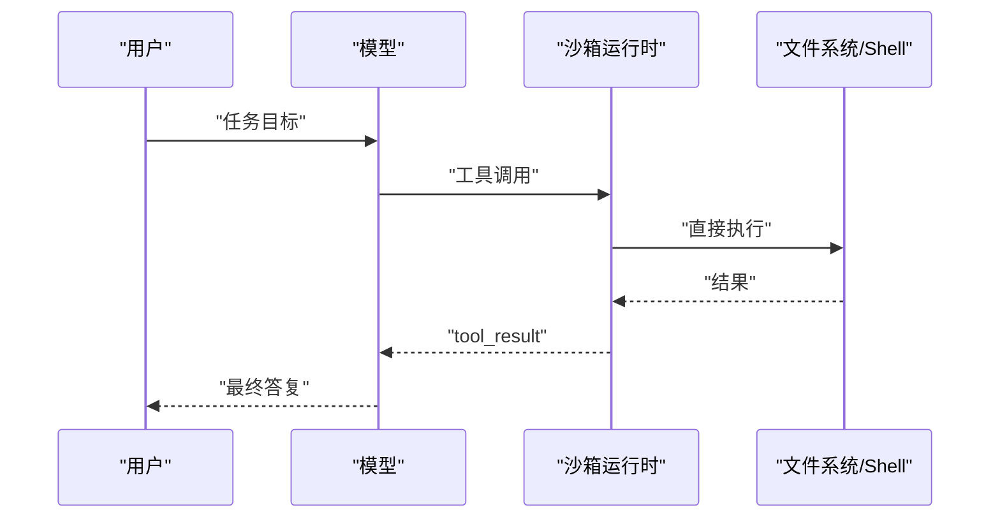
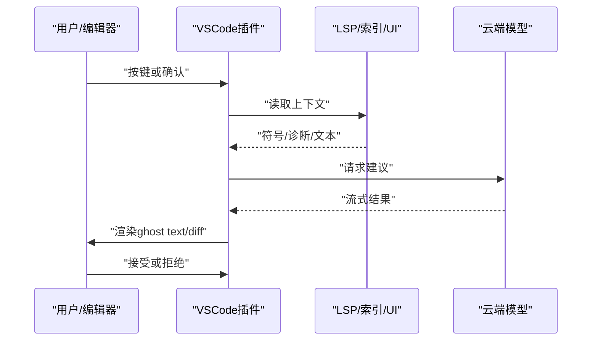

# MonkeyCode 沙箱模式与 VSCode 插件模式速度对比

## 一、结论

MonkeyCode 这类沙箱 Agent 模式在“生成文档、改代码、跑命令、提交发布”这类任务上，通常比 VSCode 插件模式更快，核心原因不是单一的模型速度，而是整条执行链路更短：

1. 模型输出工具调用，运行时直接执行，不经过编辑器 UI 渲染。
2. 文件读写是原子工具调用，不经过 LSP 增量分析、diff 计算和 ghost text 渲染。
3. 一次模型响应可以并行触发多个工具调用，减少串行轮次。
4. 长任务可以放入后台终端，不阻塞主对话。
5. 上下文通过文件读取直接注入，不需要先构建符号索引再检索。
6. 编译、测试、Git、打包、发布都在本地沙箱内完成，避免浏览器/IDE 与远程服务之间的多次上传下载。

因此，沙箱模式的优势主要来自“工程链路更短、工具执行更直接、并行度更高”。VSCode 插件模式更适合实时补全、IDE 内导航和交互式协作。

## 二、两种模式的调用链对比

### 2.1 沙箱 Agent 模式

以 MonkeyCode/OpenCode 这类 Agent 为例，一次任务调用链大致是：

```text
用户目标
  -> 模型生成工具调用
  -> Agent 运行时解析工具 JSON
  -> 直接在沙箱内执行 read/write/edit/bash/glob/grep
  -> 文件系统或命令结果返回
  -> 模型继续推理或结束
```

对应到实际工具，常见调用是：

```text
read(filePath)
write(filePath, content)
edit(filePath, oldString, newString)
bash(command)
glob(pattern)
grep(pattern)
task(subagent)
background_terminal_create(command)
```

这些工具的特点是：输入输出边界清晰、执行位置固定在沙箱、结果直接回到模型上下文。

### 2.2 VSCode 插件模式

典型 VSCode AI 插件的调用链更长：

```text
用户按键或点击
  -> VSCode Extension Host 捕获事件
  -> 读取编辑器 buffer、光标、诊断、LSP 符号
  -> 组装上下文
  -> 请求云端模型
  -> 流式接收补全或编辑建议
  -> 计算 diff
  -> 渲染 ghost text 或 inline diff
  -> 用户接受/拒绝
```

插件模式不是直接执行结果，而是“建议 -> 展示 -> 用户确认 -> 应用”。每一步都有额外开销。

## 三、代码级路径对比

### 3.1 沙箱模式的文件修改路径

沙箱模式中，修改一个文件通常是：

```typescript
const result = write({
  filePath: "/workspace/docs/demo.md",
  content: "new content",
});
```

运行时直接打开文件、写入、返回结果。没有编辑器 buffer 同步，没有 diff 预览，没有 LSP 重新诊断。

再次修改时可以使用精确替换：

```typescript
edit({
  filePath: "/workspace/docs/demo.md",
  oldString: "old",
  newString: "new",
});
```

这条路径的耗时主要来自模型推理和文件系统 I/O，链路很短。

### 3.2 VSCode 插件模式的文件修改路径

典型 VSCode 插件修改文件时，需要经过更多层：

```typescript
const edit = new WorkspaceEdit();
edit.replace(uri, range, newText);
await workspace.applyEdit(edit);

await window.showTextDocument(document);
await editor.edit((builder) => {
  builder.replace(range, newText);
});
```

如果涉及补全建议，还要经过：

```typescript
const provider = vscode.languages.registerInlineCompletionItemProvider(
  { pattern: "**/*" },
  {
    async provideInlineCompletionItems(document, position, context, token) {
      const context = await buildEditorContext(document, position);
      const response = await requestModel(context);
      return toInlineCompletionItems(response);
    },
  }
);
```

这里至少包含：

- 读取 `document.getText()`。
- 读取光标、选区、诊断。
- 读取 LSP 符号或工作区索引。
- 组装 prompt。
- 请求模型。
- 流式接收。
- 计算插入位置。
- 渲染 ghost text。
- 等待用户接受。

## 四、影响速度的关键因素

| 因素 | 沙箱 Agent 模式 | VSCode 插件模式 | 影响 |
|------|------------------|------------------|------|
| 执行位置 | 本地沙箱直接执行 | 编辑器 + 云端模型 + UI | 沙箱更短 |
| 文件访问 | `read/write/edit` 直接操作 | buffer + LSP + diff | 沙箱更快 |
| 并行度 | 一次响应可并行多工具 | 通常单请求单建议 | 沙箱更快 |
| 长任务 | 后台终端不阻塞 | 大多仍在 UI 会话内 | 沙箱更顺 |
| 上下文 | 文件内容直接注入 | 索引、符号、诊断、buffer 多层组装 | 沙箱更直接 |
| 用户确认 | 工具调用即执行 | ghost text/diff 需确认 | 插件交互更强 |
| 适用范围 | 文件、脚本、Git、发布 | 实时代码补全、IDE 导航 | 各有优势 |

## 五、为什么体感上比灵码 4.0 快

这里需要区分“模式优势”和“模型优势”。

灵码 4.0 是 VSCode 插件形态，天然要处理编辑器状态、LSP 上下文、补全渲染和用户确认。即使模型本身很快，端到端时延也会被这些层放大。

沙箱 Agent 模式把“理解需求 -> 读文件 -> 改文件 -> 跑命令 -> 提交”压缩成连续的工具调用。尤其在以下任务里优势明显：

- 生成一份完整文档。
- 批量修改多个文件。
- 查找代码链路并整理报告。
- 执行 SQL、Git、打包、发布。
- 需要多轮工具调用但不需要 IDE 交互。

例如本次任务中，读取代码、生成 MD、执行 Git、替换 release 资产，都可以在同一沙箱内连续完成，不需要在编辑器中逐段接受建议。

## 六、沙箱模式也有代价

沙箱模式不是全面更快，它也有成本：

1. 需要清晰的工具边界，否则容易产生大上下文。
2. 缺少 IDE 的实时可视化 diff，用户审阅成本更高。
3. 对浏览器、桌面 GUI、本地 IDE 插件无直接控制。
4. 长任务需要后台终端管理，否则会阻塞会话。
5. 工具调用失败时需要模型自行纠错。

所以两种模式不是替代关系，而是适用场景不同：

- 要快速完成文件级、仓库级、发布级任务：沙箱 Agent 更快。
- 要在编辑器里实时补全、跳转、重构：VSCode 插件更顺手。

## 七、架构图





## 八、最终判断

MonkeyCode 沙箱模式的“快”，主要来自工程链路短、工具直接执行、批量并行和本地闭环。VSCode 插件模式的“慢”，主要来自编辑器集成层、上下文组装、UI 渲染和用户确认。

如果比较的是同一模型在两种模式下的端到端体感，沙箱模式在文档生成、代码排查、仓库操作、发布交付这类任务上通常优势明显。如果比较的是纯模型推理速度，则要看具体模型版本、上下文长度、网络链路和缓存命中情况，不能只用模式差异解释。